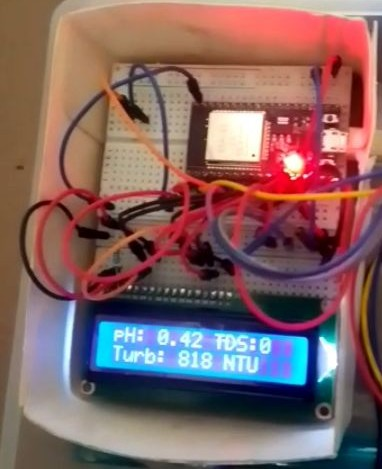
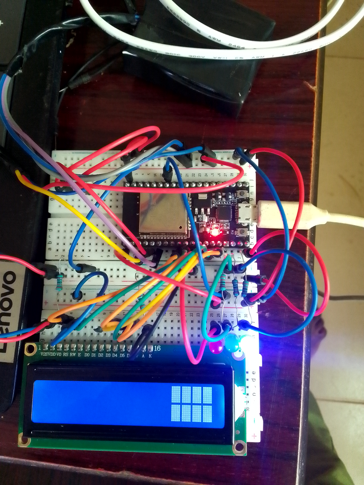

# Water Quality Monitor (ESP32)

A portable water quality monitor built on an ESP32. It reads **pH**, **TDS** (total dissolved solids) and **turbidity** (cloudiness) from three analog sensors and shows the results on a 16x2 LCD, with the same readings printed to the serial monitor.



> I lost all my vids on a device I lost. So this is all I've got.


> A common error I faced because I misconnected the `v0` pin, which eventually destroyed the lcd display.


## Features

- Measures three water quality indicators: pH, TDS and turbidity
- Live readings on a 16x2 LCD, refreshed every second or so
- Serial output at 9600 baud for debugging and logging
- pH readings are smoothed: ten samples are taken, sorted, and the highest and lowest are thrown away before averaging
- Adjustable pH calibration constant in the code
- Written in embedded C++ (Arduino framework) for the ESP32

## Parts list

| Part | Quantity | Notes |
| --- | --- | --- |
| ESP32 development board | 1 | Fill in your exact board |
| Analog pH sensor module (probe + signal board) | 1 | Fill in the model |
| Analog TDS sensor | 1 | Fill in the model |
| Analog turbidity sensor | 1 | Fill in the model |
| 16x2 character LCD (HD44780, parallel) | 1 | |
| Potentiometer for LCD contrast | 1 | |
| RGB LED | 1 | Optional: the pins are declared in the code, but it is not used yet |
| Jumper wires, breadboard | | |
| Power supply | 1 | |

## Wiring

**Sensors (analog inputs)**

| Sensor | ESP32 pin |
| --- | --- |
| pH sensor | GPIO 34 |
| Turbidity sensor | GPIO 35 |
| TDS sensor | GPIO 36 |

**LCD (4-bit mode)**

| LCD pin | ESP32 pin |
| --- | --- |
| RS | GPIO 25 |
| E | GPIO 26 |
| D4 | GPIO 14 |
| D5 | GPIO 27 |
| D6 | GPIO 12 |
| D7 | GPIO 13 |

Also connect the LCD's power, ground, contrast and backlight pins as usual, and tie the RW pin to ground.

**Voltage note:** the ESP32's analog inputs only tolerate **3.3 V**. Many pH and turbidity modules output up to 5 V, so check your modules' output range and use a voltage divider or level shifting if needed.

The sketch also sets up three pins for an RGB LED (`redLED`, `grnLED`, `bluLED`), but nothing drives them yet.

Add a wiring diagram or circuit photo in the `images/` folder and link it here.

## Getting started

1. Install the [Arduino IDE](https://www.arduino.cc/en/software) and add ESP32 board support through the Boards Manager.
2. The sketch uses the `LiquidCrystal` library. Install it from the Library Manager if it is not already available.
3. Clone this repository:
   ```bash
   git clone https://github.com/Ehiejakhian/water-quality-monitor-esp32.git
   ```
4. Open the sketch in the Arduino IDE, select your ESP32 board and port, and upload.
5. Open the Serial Monitor at **9600 baud** to see the readings.

## How it works

Every cycle, the ESP32 reads each sensor, converts the raw value to a voltage (the ESP32's ADC is 12-bit, so raw values run from 0 to 4095 across 0 to 3.3 V), and turns that into a reading:

1. **TDS:** the voltage goes through a polynomial conversion to estimate dissolved solids.
2. **Turbidity:** the voltage is converted to an approximate NTU value. Clear water gives a high voltage and reads as 0 NTU.
3. **pH:** ten samples are taken 30 ms apart and sorted. The two lowest and two highest are dropped, and the middle six are averaged. The average voltage is converted to pH using a slope and a calibration constant (`calibration_value`).
4. The readings are shown on the LCD (pH and TDS on the first line, turbidity on the second) and printed over serial.

A full cycle takes a little over a second because of the pH sampling and a one-second delay at the end of the loop.

## Calibration

These are low-cost sensors, and the numbers they give are **estimates**, not lab-grade measurements.

- **pH:** the sketch has a `calibration_value` you adjust until the reading matches a known solution. Calibrate with buffer solutions (for example pH 4 and pH 7) and re-check periodically.
- **TDS and turbidity:** the conversion formulas are general approximations. For meaningful numbers, compare against a reference meter or known solutions and adjust.

## Limitations and next steps

- Readings are uncalibrated approximations until you calibrate against known solutions.
- There is no temperature sensor in this version. TDS and pH readings both drift with temperature, so adding one for compensation is the natural next step.
- There is no wireless or cloud connectivity yet: readings show on the LCD and the serial monitor only. Adding Wi-Fi logging or a web dashboard would make it a true IoT device.
- Ideas to improve it: use the RGB LED as a quality indicator (for example green, yellow and red bands), show pH with a decimal place on the LCD, add data logging, and build a waterproof enclosure.

## Author

Built by [Ehi Ejakhian](https://ehiejakhian.github.io). See more of my projects on my [portfolio](https://ehiejakhian.github.io/embedded-sys/).
